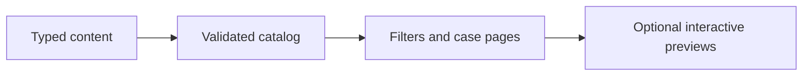

# Kauan Tavares — Portfolio

A content-driven portfolio for automation, software development and data projects.

**Next.js, React, TypeScript, React Three Fiber, GSAP, Framer Motion, Lenis**

## What it does

- Typed project catalog with combined filters, derived metrics and individual case pages.
- Accessible dashboard modal loads an iframe only after an explicit open action.
- Responsive control-center identity, motion preferences, static fallbacks and generated metadata.

## Workflow



## Local setup and use

```powershell
npm ci
npm run dev
```
Use a maintained Node.js LTS release. `npm run build` produces the local production build; it does not publish it.
Run `npm run validar`, `npm test` and `npm run lint`. `SITE_URL` is required for publication validation. See [content authoring](docs/ADDING-PROJECTS.md).

## Configuration

Environment names declared by the included examples (values must be supplied locally):

`AUDIT_URL`, `SITE_URL`.

## Boundaries and limitations

The published demonstrations use fictitious data, as confirmed by the author. Third-party dashboards still depend on the external service. Editorial pending fields are tracked by the validator. This repository update does not deploy the website.

This is a source snapshot, not a claim of production readiness. Business results, dates and unmeasured performance are intentionally not asserted. Application UI language is preserved.

## License

Original application code is available under the [MIT license](LICENSE). Third-party libraries, models, fonts and bundled assets retain their own licenses.

## Verification record

See [snapshot checks and remaining limitations](docs/VERIFICATION.md).
